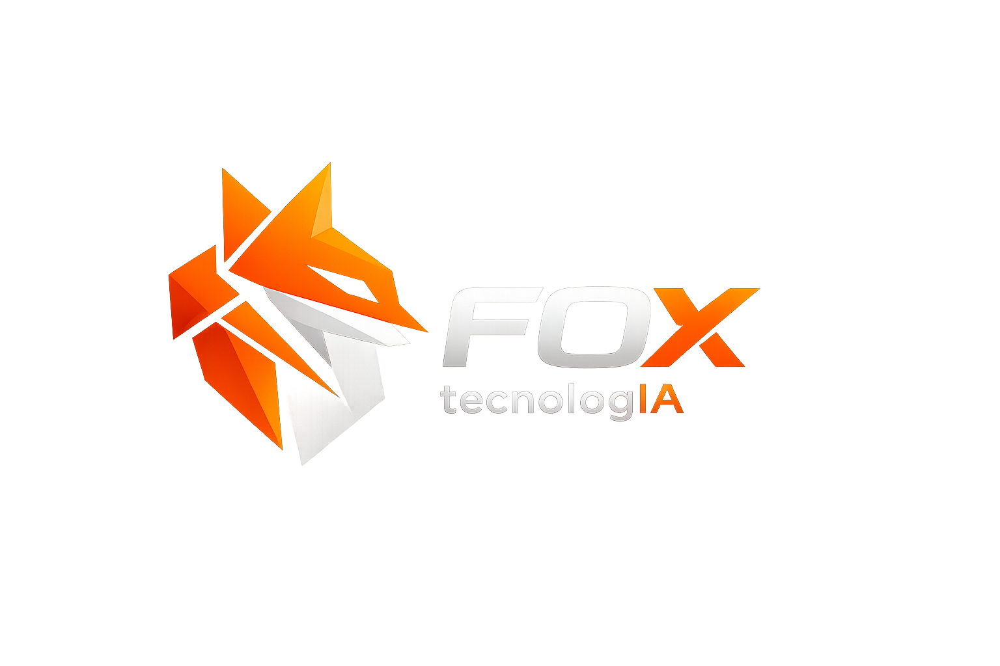

<div align="center">

<picture>
  <source media="(prefers-color-scheme: dark)" srcset="public/brand/fox-logo-light.png">
  
</picture>

# FOX tecnologIA

**Licenças, IA e sistemas de gestão para quem precisa fazer mais.**

[](https://www.foxtecnologia.online)
[](https://nextjs.org)
[](https://www.typescriptlang.org)
[](https://vercel.com)

[🌐 Site oficial](https://www.foxtecnologia.online) · [📩 contato@foxtecnologia.online](mailto:contato@foxtecnologia.online)

</div>

---

## Sobre a FOX

A FOX tecnologIA fornece **licenças de software e IA, sistemas de gestão e serviços** para **governo e empresas em todo o Brasil**, com propostas claras, resposta rápida a prazos de edital e suporte depois da compra. Além disso, desenvolve **produtos próprios movidos a inteligência artificial**.

Este repositório é o **código do site oficial** — [foxtecnologia.online](https://www.foxtecnologia.online).

## O que a FOX entrega

| Frente | O que entregamos |
|---|---|
| 🤖 **Inteligência artificial** | Licenças corporativas de ChatGPT, Claude, Gemini e Copilot, com orientação de uso para a equipe |
| 🏢 **Produtividade e colaboração** | Microsoft 365, Google Workspace, e-mail corporativo e armazenamento em nuvem |
| 🔐 **Licenças de software** | Segurança, design/CAD, sistemas operacionais e backup, conforme as especificações do edital |
| 📊 **Sistemas de gestão** | Soluções de gestão pública e empresarial, do protocolo ao financeiro |
| 🛠️ **Serviços** | Implantação, treinamento em IA, suporte técnico e nuvem |

### Licitações e compras

Pregão eletrônico (Lei 14.133) · Dispensa de licitação · Adesão a ata (SRP) · Pesquisa de preços · Compras corporativas

```text
 Envie o edital  →  Análise técnica  →  Proposta e habilitação  →  Entrega e pós-venda
```

## Produtos próprios

| Produto | O que faz |
|---|---|
| [**ZapScript.me**](https://zapscript.me) | Transcreve e resume os áudios do WhatsApp. Leia em segundos o que levaria minutos para ouvir. |
| [**MyKollect**](https://mykollect.com) | Tire uma foto, a IA identifica o item e você confirma. Catalogue sua coleção sem digitar nada. |
| [**Documentos.shop**](https://documentos.shop) | Gere, organize e gerencie documentos digitais em um só lugar. |
| [**Makeapp.me**](https://makeapp.me) | Crie e publique seus próprios aplicativos, sem programar. |

---

## O site

| Rota | Conteúdo |
|---|---|
| `/` | Home: hero, categorias, bento de licitações, produtos e bloco de cotação |
| `/licitacoes` | Catálogo de fornecimento, modalidades, passo a passo e perguntas frequentes |
| `/produtos` | Os produtos próprios da FOX |
| `/sobre` | Posicionamento e pilares da empresa |
| `/contato` | Formulário de cotação |
| `/api/contact` | Endpoint do formulário (e-mail via SMTP) |

**Destaques técnicos**

- **Formulário de cotação** validado com Zod, com honeypot anti-robô, limite de 5 envios por IP a cada 10 minutos (por instância) e e-mail de confirmação ao remetente. Se o envio falhar, oferece o WhatsApp como alternativa.
- **SEO:** `sitemap.xml`, `robots.txt`, metadados por página, Open Graph e JSON-LD (`Organization` e `SoftwareApplication` por produto).
- **Segurança:** headers `X-Content-Type-Options`, `X-Frame-Options`, `Referrer-Policy` e `Permissions-Policy`.
- **Acessibilidade e performance:** contraste WCAG AA, páginas pré-renderizadas (estáticas), fontes otimizadas com `next/font`.

## Stack

`Next.js 14 (App Router)` · `React 18` · `TypeScript` · `Tailwind CSS` · `react-hook-form` + `Zod` · `Nodemailer (SMTP Zoho)` · `lucide-react` · `Vercel`

## Começando

**Requisitos:** Node.js 18.17 ou superior e npm.

```bash
npm install
npm run dev
```

O site abre em <http://localhost:3000>.

| Comando | O que faz |
|---|---|
| `npm run dev` | Servidor de desenvolvimento |
| `npm run build` | Build de produção |
| `npm run start` | Serve o build de produção |
| `npm run lint` | ESLint (`next lint`) |

### Variáveis de ambiente

Crie um `.env.local` na raiz (já ignorado pelo Git). **Nunca** versione credenciais.

| Variável | Obrigatória | Descrição |
|---|---|---|
| `ZOHO_EMAIL` | Sim, para o formulário | Conta que envia e recebe as cotações |
| `ZOHO_PASSWORD` | Sim, para o formulário | **Senha de aplicativo** do Zoho, não a senha da conta |
| `ZOHO_SMTP_HOST` | Não | Padrão: `smtp.zoho.com` |
| `ZOHO_SMTP_PORT` | Não | Padrão: `587` |
| `MYCOLLECT_CLOUD_RUN_URL` | Não | Se definida, ativa o rewrite de `/mycollect` para o app MyKollect |

Sem as credenciais do Zoho o site funciona normalmente, mas o envio do formulário retorna erro.

## Estrutura

```text
src/
├── app/                 Rotas (App Router), layout, sitemap, robots e API
│   └── api/contact/     Envio do formulário de cotação
├── components/          Navbar, Footer, Products, Licitacoes, QuoteForm, ...
└── lib/
    ├── constants.ts     Fonte única de todo o conteúdo do site
    ├── contactSchema.ts Validação do formulário (Zod)
    └── email.ts         Transporte SMTP e templates de e-mail
public/                  Logos e imagens (brand/ = identidade visual)
```

## Editando o conteúdo

Todo texto de negócio (empresa, produtos, categorias, serviços, modalidades, etapas) vive em [`src/lib/constants.ts`](src/lib/constants.ts) — não é preciso mexer nos componentes para atualizar o conteúdo.

Itens ainda aguardando confirmação da FOX estão marcados como `PROVISÓRIO` e listados em [`CONTEUDO-PENDENTE.md`](CONTEUDO-PENDENTE.md). Em `npm run dev` esses blocos exibem uma etiqueta amarela; em produção ela não aparece.

## Deploy

O deploy é automático na **Vercel**: cada push na branch `main` publica em produção. Passo a passo de configuração em [`DEPLOYMENT.md`](DEPLOYMENT.md).

---

<div align="center">

**FOX tecnologia** · CNPJ 66.586.436/0001-12 · Atendimento em todo o Brasil

[foxtecnologia.online](https://www.foxtecnologia.online) · [contato@foxtecnologia.online](mailto:contato@foxtecnologia.online)

<sub>Marcas citadas pertencem aos seus respectivos titulares; a menção não indica parceria oficial.<br>© FOX tecnologia. Todos os direitos reservados.</sub>

</div>
